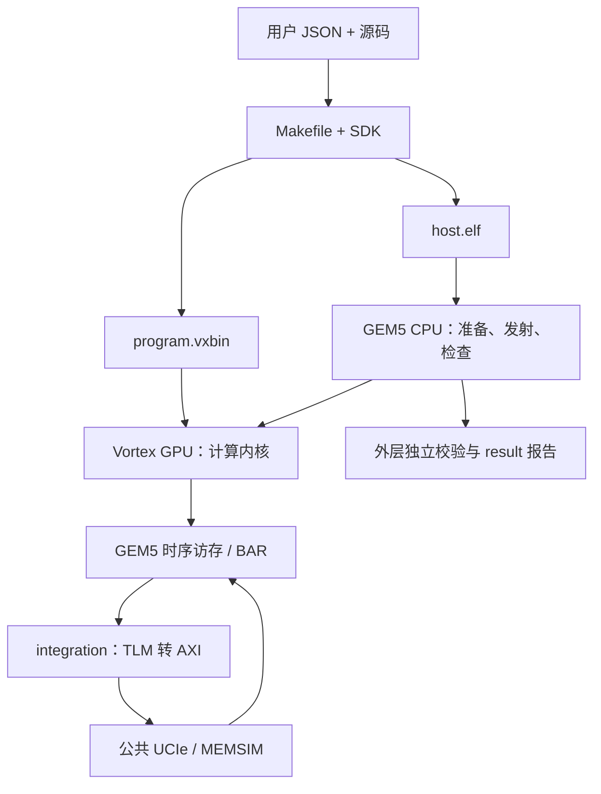

# Vortex：用户程序怎么配置和运行

用户程序放在 `user/`：先在 `config.json` 里选参数，再改 `src/` 中的代码，最后用 `run.sh` 执行。
这里说明每个文件的作用。需要运行时，请打开同名的项目仓库，按那里的命令操作。
先看 config.json，再看 Makefile 和计算源码，最后看 run.sh 如何把各阶段串起来。

## 按文件找说明

| 文件 | 用途 |
| --- | --- |
| [run.sh.md](run.sh.md) | 选择项目，完成编译、运行、校验和结果归档 |
| [.gitignore.md](.gitignore.md) | 忽略生成结果和 Python 缓存 |
| [smoke/config.json.md](smoke/config.json.md) | 该负载的全部用户配置 |
| [smoke/src/Makefile.md](smoke/src/Makefile.md) | 声明源码和公共编译规则 |
| [smoke/src/host.cpp.md](smoke/src/host.cpp.md) | GEM5 CPU 主机程序及多线程工作 |
| [smoke/src/kernel.cpp.md](smoke/src/kernel.cpp.md) | Vortex GPU 计算程序 |
| [smoke/result/README.md](smoke/result/README.md) | 生成输出按文件类型解释 |
| [llm/config.json.md](llm/config.json.md) | 该负载的全部用户配置 |
| [llm/src/Makefile.md](llm/src/Makefile.md) | 声明源码和公共编译规则 |
| [llm/src/host.cpp.md](llm/src/host.cpp.md) | GEM5 CPU 主机程序及多线程工作 |
| [llm/src/kernel.cpp.md](llm/src/kernel.cpp.md) | Vortex GPU 计算程序 |
| [llm/src/llm_parallel.h.md](llm/src/llm_parallel.h.md) | GPU 共享局部内存与各线程工作量 |
| [llm/src/tinyllm.h.md](llm/src/tinyllm.h.md) | 模型结构、权重和布局 |
| [llm/result/README.md](llm/result/README.md) | 生成输出按文件类型解释 |

## 运行顺序

平台准备见 [build.sh.md](../build.sh.md)，桥接细节见 [integration 导航](../integration/README.md)。

## 从结果找到对应源码

第一次可以只读 SMOKE 的几份文件：

1. `config.json.md`：确认输入是 41，配置控制哪些部件。
2. `host.cpp.md` 再 `kernel.cpp.md`：先看 CPU 准备数据，再看 GPU 加一。
3. `src/Makefile.md`：确认编译的是刚读过的文件。
4. `result/README.md`：确认怎样检查输出 42。
5. `run.sh.md`：把编译、运行、校验串起来。

同名的 smoke、llm 各有独立配置和结果目录。修改 smoke 的 JSON 不会改变 llm 的输入。
根目录构建得到的 `result/build/` 只是预编译出的文件；一次完整运行会另建结果目录。

## 新建任务要准备哪些文件

| 文件 | 是否手工维护 | 用途 |
|---|---|---|
| `config.json` | 是 | 输入、平台参数、检查方式 |
| `src/Makefile` | 是 | 列出要编译的源码，接入 SDK |
| `host.cpp/kernel.cpp` | 是 | 实现计算和必要的输入输出处理 |
| `project_config.h` | 否 | 构建器根据 JSON 自动生成 |
| `result/某次运行/` | 否 | 每次运行的快照、产物与检查记录 |

具体可复制的实验命令见 [原项目配置实验](https://github.com/hy2581/vortex_StorageStacked/blob/977cfe8acb737d2f99a6304135a861ba8112ca9c/docs/06-%E9%85%8D%E7%BD%AE%E5%AE%9E%E9%AA%8C%E4%B8%8EUSER%E8%B4%9F%E8%BD%BD%E8%AF%A6%E8%A7%A3.md)。
