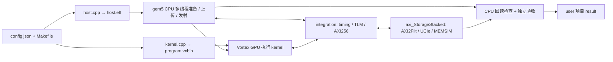

# Vortex StorageStacked

阅读入口：[文档目录](docs/README.md) · [逐文件中文讲解](https://github.com/hy2581/StorageStacked-docs)。

离线 Docker 包及最新兼容脚本见 [离线发布仓库](https://github.com/hy2581/zhongxing-storagestacked-offline)。
旧版 Docker 编译出现 `posix_spawn failed: Operation not permitted` 时，按
[Docker 兼容说明](https://github.com/hy2581/zhongxing-storagestacked-offline/blob/main/DOCKER_COMPATIBILITY.md)
使用临时入口；源码和文档可通过该入口的 `shell` 命令查看。

基于 gem5 多核 CPU 与 Vortex GPU 执行用户程序，经 AXI256、UCIe 访问在线 MEMSIM。用户在 `user/` 配置、编译、运行和查看结果；`integration/` 提供与独立 AXI 存储项目的连接。

## 目录

```text
vortex_StorageStacked/
├── README.md
├── build.sh
├── user/
│   ├── run.sh
│   ├── smoke/               config.json + src/Makefile、host.cpp、kernel.cpp + result/
│   └── llm/                 config.json + src/、模型与并行计算头文件 + result/
├── docs/                    用户说明和研究成果分析
├── third_party/
│   ├── gem5/                CPU 仿真、平台构建与运行支持
│   └── vortex/              GPU 仿真与应用 SDK
└── integration/             gem5/TLM 到公共 AXI 存储的桥接
```

## 首次构建

将两个仓库放在同级目录：

```bash
git clone https://github.com/hy2581/axi_StorageStacked.git
git clone https://github.com/hy2581/vortex_StorageStacked.git
cd vortex_StorageStacked
./build.sh --storage ../axi_StorageStacked --jobs 12
```

环境为 Linux x86-64；首次构建准备固定版本工具和平台。使用相对路径保存依赖位置，不使用 submodule。复制源码到新位置后重新执行 `build.sh`，脚本管理内部缓存。

## 运行项目

```bash
cd user
./run.sh smoke
./run.sh llm
# 自选结果目录，每次使用新目录
./run.sh smoke --output result/my-check
```

- **SMOKE**：CPU 多线程准备默认输入 `41` 并上传，GPU 四个工作组分别读入、加一，CPU 回读检查输出 `42`。
- **LLM**：与 CoralNPU 示例采用相同 TinyLLM 模型；输入 `"red "`，生成 `"blu"`，token ID `[4, 10, 15]`。线性层使用 SIMT FP32，默认 8 个 GPU 线程协作计算。

每个项目只有一个 `config.json`。其中配置程序输入、GPU 核/warp/线程、CPU ISA 与核数、MMU/TLB、缓存、AXI、UCIe、MEMSIM 和仿真上限。修改后直接运行；需要更新的平台编译由入口处理。

`host.isa` 可选 `x86_64`（默认）或 `aarch64`（64 位 ARM）。例如在 `user/smoke/config.json` 的 `host` 中设置 `"isa": "aarch64"`，然后执行 `cd user && ./run.sh smoke`。首次选择 ARM 会构建独立的 gem5 ARM 平台和对应主机运行库；已构建的 x86/ARM 平台可复用，`host.elf` 随本次 ISA 编译，GPU 仍执行 RV32。ARM 需要系统安装 `g++-aarch64-linux-gnu`、`libc6-dev-arm64-cross`；详见[环境配置说明](docs/01-用户环境配置说明.md#31-选择-x86-或-arm-主机)。

CPU 和 GPU 的 L1I、L1D、L2 均可设置相联度（`l1i_ways` 等）和访问周期（`l1i_latency_cycles` 等）。CPU 模型固定 TimingSimpleCPU；GPU 的 `"auto"` 周期保留原有容量关联规则。字段和范围见[环境配置说明](docs/01-用户环境配置说明.md)，两种主机与修改后参数的实测结果见[验证说明](docs/07-验证说明.md)。

打开用户源码即可看到两类程序的分工：

| 程序 | 编译成果与执行位置 | 负责的工作 |
|---|---|---|
| [SMOKE host.cpp](user/smoke/src/host.cpp) / [LLM host.cpp](user/llm/src/host.cpp) | `host.elf`，gem5 的 x86 或 AArch64 CPU | 多线程准备输入、上传、发射 GPU、回读和分片检查 |
| [SMOKE kernel.cpp](user/smoke/src/kernel.cpp) | `program.elf / program.vxbin`，Vortex GPU | 读取输入、加一、写回 |
| [LLM kernel.cpp](user/llm/src/kernel.cpp) | `program.elf / program.vxbin`，Vortex GPU | 使用 `tinyllm.h` 中的模型执行 prefill 和逐 token 推理 |

**gem5 多核**由 `host.num_cpus` 配置，示例的 `host.cpp` 按核数创建工作线程。默认四核 SMOKE 每线程处理一份输入，两核时每线程处理两份，输出均为 `42`。`gpu.cores` 配置 GPU 核数，SMOKE 的 `program.workers` 配置 GPU 工作组数。修改方法和报告字段见[环境配置说明第 6 节](docs/01-用户环境配置说明.md#6-cpugpu-分别跑什么cpu-多核怎么看)，两核/四核操作见[SMOKE 指南第 7 节](docs/02-用户从0开始添加SMOKE简要指南.md#7-比较四核和两核)。

新增项目遵循同样结构：`user/<项目>/config.json` 和 `src/Makefile`、源文件。`./run.sh <项目>` 不需要注册项目名，Makefile 通过 SDK 生成主机及设备程序。

## 输出和验收

结果保存到 `user/<项目>/result/<运行目录>/`。入口打印 `report.md` 位置；成功要求 `summary.json` 的 `passed: true`。

先看 `report.md`；`host_summary.json` 给出线程分片和每核实际指令、缓存及 MMU 活动，`build/programs.json` 对应 CPU/GPU 程序，`build/sources/` 保存本次源码。目录还保存配置、实际回读字节、AXI VCD、Flit、内存记录和链路视图。TinyLLM 会逐项核对权重、KV、中间结果、token、线性层调用数和各 GPU 线程的实际工作量。
LLM 使用一个工作组，线程数为 `min(8, gpu.threads × gpu.warps)`；一个工作组在一个 GPU 核上执行。
归一化、注意力和生成控制由组内线程 0 完成，线性层输出列由各线程分工计算。

```bash
# 在 user/ 中执行单类回归
./run.sh smoke --test
./run.sh llm --test
# 在仓库根目录执行整体构建与回归
./build.sh --test
```

平台回归执行一次：默认 SMOKE 和默认 LLM 各运行一次，并执行原生内存测试、在线内存接口和错误拒绝检查。默认 SMOKE 为 `41 → 42`，TinyLLM 为 `"red " → "blu"`；核对 CPU 多核实际执行、GPU 各线程完成的输出列数、独立数值和完整存储链路。各场景结果位于 `user/<项目>/result/test-<时间>/<场景>/`，整体汇总路径由测试入口打印。单独执行 `./run.sh llm --test` 时，默认 LLM 仿真只运行一次。执行结果统一见 [验证说明](docs/07-验证说明.md)。新增项目的复现步骤见 [SMOKE 指南](docs/02-用户从0开始添加SMOKE简要指南.md)。

## 运行链路



主机程序和栈使用主机内存；主机访问 GPU BAR 和 GPU 外部访存走公共存储链路。设备执行、缓存行为、实际返回数据和存储延迟共同决定仿真结果。gem5 使用自带的一套 SystemC，时间基准为 1 fs。

`axi_StorageStacked` 提供统一存储接口；`coralnpu_StorageStacked` 通过其原生 NPU 桥独立接入相同接口，各运行实例拥有独立内存状态。

## 文档

| 文档 | 内容 |
|---|---|
| [用户环境配置说明](docs/01-用户环境配置说明.md) | 准备环境、全部参数、运行和输出 |
| [从 0 添加 SMOKE 简要指南](docs/02-用户从0开始添加SMOKE简要指南.md) | 按步骤添加新项目，解释输入和输出 |
| [LLM 简要说明](docs/03-LLM简要说明.md) | CPU/GPU 源码、推理流程、KV 和数值核对 |
| [integration 介绍](docs/04-integration介绍.md) | 七个文件各自职责与流程图 |
| [研究成果一分析](docs/05-研究成果一分析.md) | 三项目如何实现 SoC 模型各项内容 |

源码版本、许可证与平台适配记录见 [gem5 来源说明](third_party/gem5/patches/README.md)和 [Vortex 来源说明](third_party/vortex/patches/README.md)。
