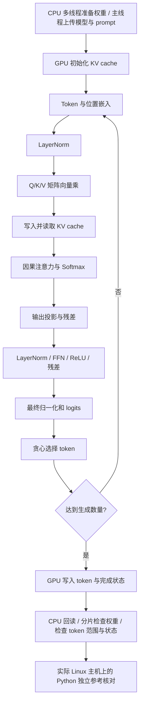
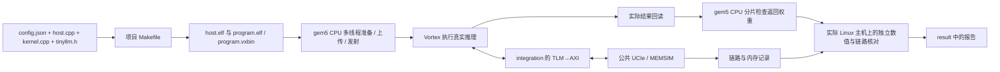

# LLM 简要说明

[返回文档目录](README.md)。

## 1. 文件和输入

```text
user/llm/
├── config.json
├── src/
│   ├── Makefile
│   ├── tinyllm.h
│   ├── host.cpp
│   ├── kernel.cpp
│   └── llm_parallel.h
└── result/
```

| 文件 | 执行位置与阅读顺序 |
|---|---|
| [host.cpp](../user/llm/src/host.cpp) | 按 `host.isa` 编译为 x86-64 或 AArch64 `host.elf`，由 gem5 CPU 执行：`on_cpu_cores()` 分片准备权重 → `vx_enqueue_write()` 上传权重和 prompt → `vx_enqueue_launch()` 启动 GPU 程序 → `readback_all()` 回读 → 分片检查 |
| [kernel.cpp](../user/llm/src/kernel.cpp) | 编译为 `program.elf / program.vxbin`，由 Vortex 执行：从 `kernel_main()` 看整体流程，再看 `forward()`、`norm()`、`linear()` |
| [tinyllm.h](../user/llm/src/tinyllm.h) | 两份程序共用的模型定义：参数、权重、词表和布局 |
| [llm_parallel.h](../user/llm/src/llm_parallel.h) | 组内共享局部内存结构：中间向量、计数与每线程工作量 |
| [Makefile](../user/llm/src/Makefile) | `HOST_SOURCES` 指定 CPU 源码，`KERNEL_SOURCES` 指定 GPU 源码，`MODEL_HEADER` 指定模型头文件 |

模型与 CoralNPU 示例一致，计算流程也保持对应，设备入口和数学函数使用 Vortex SDK。

模型为单层字符 Transformer：1001 个参数，隐藏维度 8、2 个注意力头、FFN 维度 16、上下文 16、词表 17。头文件中权重按对齐布局保存，共 1004 个 float。用户不需要下载模型、运行训练程序或生成权重文件。

日常修改 `config.json`：

```json
{
"program": {
  "type": "tiny_llm",
  "prompt": "red ",
  "generated_tokens": 3,
  "kv_cache": true
}
}
```

其余 GPU、CPU/MMU/缓存、AXI、UCIe、MEMSIM 参数也在同一 JSON 中，见[环境配置说明](01-用户环境配置说明.md)。

## 2. 程序做什么



CPU 程序负责准备和传输输入；GPU 程序分三段：初始化 KV cache；第一轮 prefill、后续 decode；写入结果和完成状态。`forward()` 包含一整个位置的计算，`norm()`、`linear()` 等小函数对应基本算子。

开启 KV cache 后，第一轮处理完整 prompt，后续每轮只计算新位置。关闭后每轮重算当前前缀。两种方式应生成相同 token，可用来观察访存和执行周期差异。

推理在 GPU 内核中执行，使用 FP32。`linear()` 中线程 t 处理输出列
`t, t + blockDim.x, t + 2 × blockDim.x, ...`，每列仍按输入行顺序累加。
中间数组放在工作组的共享局部内存，由 `launch.lmem_size` 分配，
阶段之间使用 `__syncthreads()`；
线程 0 的串行阶段和输出列尾块使用 `vx_split/vx_join` 显式控制活动线程，LayerNorm、注意力、Softmax、贪心选择及观测记录由组内线程 0 完成。
这是 SIMT 多线程计算，程序没有使用 RVV 指令。SDK 提供单精度平方根和 Softmax 所需指数函数。仿真完成后，运行入口在实际 Linux 主机上执行 Python 参考程序，以 FP64 独立重算完整前缀并核对设备实际输出；这部分属于验收，不计入模拟 CPU 的执行统计。

CPU 默认四核；准备与回读检查两个阶段都按下表分工。`host.cpp` 的 `on_cpu_cores()` 用 `std::thread` 和屏障执行这些任务，主线程还负责上传与发射。

| 工作线程编号 | 权重存储字下标，左闭右开 | 数量 |
|---|---|---:|
| 0 | `[0, 251)` | 251 |
| 1 | `[251, 502)` | 251 |
| 2 | `[502, 753)` | 251 |
| 3 | `[753, 1004)` | 251 |

修改 `host.num_cpus` 会重新划分这 1004 个存储字。LLM 内核发射一个 GPU 工作组，组内线程数为 `min(8, gpu.threads × gpu.warps)`。
默认配置使用 8 个线程、2 个 warp，运行在一个 GPU 核上。
CPU 多核负责输入准备和返回权重检查；GPU 线性层的输出列由多个线程分工计算。

## 3. 外部数据布局

| GPU 地址 | 数据 | 谁写入 |
|---|---|---|
| `0x90000000` | 运行时权重 | CPU 上传，GPU 读取 |
| `0x90010000` | Key cache | GPU 初始化并在推理中更新 |
| `0x90020000` | Value cache | GPU 初始化并在推理中更新 |
| `0x90030000` | 每个位置的中间结果 | GPU 写入 |
| `0x90040000` | prompt 和后续输入 token | CPU 上传 prompt；GPU 追加后续输入 token |
| `0x90050000` | 初始化、阶段标记、生成 token、前向次数、完成状态 | GPU 写入，CPU 回读 |

GPU 的外部缓存请求经过 gem5 timing 路径，再进入 AXI/UCIe/MEMSIM。缓存命中由 GPU 缓存处理；缓存之外的请求和返回会进入原始链路记录。

## 4. 运行和输出

```bash
# 在 user/ 中执行
./run.sh llm --output result/first
cat llm/result/first/report.md
cat llm/result/first/llm_summary.json
cat llm/result/first/host_summary.json
```

默认输入 `"red "`，生成 `"blu"`，token ID 为 `[4, 10, 15]`。这是三次生成的输出；与 prompt 连起来为 `"red blu"`。

`build/program.dis` 保存设备 ELF 的反汇编，`build/sources/` 保存本次源码。
`llm_summary.json` 保存生成结果、前向计算次数、逐阶段检查数量与最大误差。验收会核对：

- 实际回读字节与在线内存最终值一致。
- 权重逐字节一致；KV 和中间结果与独立参考一致。
- prompt、生成 token、前向次数和完成状态正确。
- 线性层调用数、实际参与线程数、warp 数和每线程计算的输出列数与独立推导一致。
- AXI、Flit、MEMSIM 和 VCD 之间的数据、顺序、时刻一致。

默认 KV cache 打开，处理 6 个位置；关闭后按 4、5、6 个位置重算，共 15 次前向位置计算。两个配置的输出 token 应一致。

默认输入完成 42 次并行线性层调用，各线程处理列数为 `[60,54,54,54,54,54,54,54]`。
设备把计数写入 report，CPU 回读真实字节，独立校验结果保存在 `llm_summary.json.execution`。
在 `user/` 中执行 `./run.sh llm --test`，默认 LLM 场景运行一次，并完成相关验收。
其他配置实验可以使用 `--config` 单独运行。

CPU 分工看 `host_summary.json` 的 `phases.prepare`、`phases.check`；每核实际执行看 `cores` 和 `active_cpus`。源码与二进制对应关系看 `build/programs.json`，完整字段说明见[环境配置说明第 6 节](01-用户环境配置说明.md#6-cpugpu-分别跑什么cpu-多核怎么看)。

## 5. 完整流程



上面指定的 `llm/result/first/summary.json` 记录本次完整验收状态，`host_summary.json` 记录实际 CPU 分工，`llm_summary.json` 记录模型输出与独立数值核对结果。

## 跟着默认输入看字符怎样生成

词表给每个字符分配编号：`r=13`、`e=7`、`d=6`、空格 `=1`。
所以 `"red "` 先变成 `[13,7,6,1]`，程序计算的直接输入是这些编号。
词表只包含 `"\n .abcdehilnortuw"` 中的字符；大小写不同也会改变输入是否合法。

| 第几轮 | 已知文本 | 本轮产生 | 开 KV 时本轮计算位置数 | 关 KV 时本轮计算位置数 |
|---|---|---|---:|---:|
| 1 | `red ` | `b`，ID 4 | 4 | 4 |
| 2 | `red b` | `l`，ID 10 | 1 | 5 |
| 3 | `red bl` | `u`，ID 15 | 1 | 6 |
| 合计 | 生成部分是 `blu` | 3 个字符 | 6 | 15 |

前两轮生成的字符还要送进下一轮；第三轮已达到数量，最后的字符不再做一次前向计算。
这就是上下文约束中使用 `prompt长度 + 生成数 - 1` 的原因。

每轮实际耗时还包括访问权重、KV 和写入观测记录。
不能把 15÷6 直接当作实测加速比。比较性能时先保证两次结果与检查都通过。

## 程序里的计算步骤

| 代码中的名字 | 在程序里是什么意思 |
|---|---|
| Embedding | 把字符编号查表换成 8 个数，再加上位置对应的 8 个数 |
| LayerNorm | 计算这 8 个数的平均值和变化幅度，再调整数值尺度 |
| Q/K/V | 当前内容经过三套权重得到的数；Q 与已有 K 比较相关程度，用比较结果汇总 V |
| Softmax | 把若干分数变成非负、总和为 1 的权重 |
| FFN | 对每个位置做两次线性变换，中间把负数截成 0 |
| logits | 17 个候选字符各自的分数；程序选最高分的编号 |
| KV cache | 保存以前位置的 K/V，下次继续使用，减少重复计算 |
| trace | 程序主动写出的中间计算结果，供独立参考核对 |

## 改了输入后怎样检查结果

复制完整配置，修改 `program.prompt`，再运行 LLM。
空格和换行都可能属于输入；先核对 `input.json` 的字符串，
再核对 `llm_summary.json` 的输入 token 和生成 token。
词表外字符通常在编译准备模型输入时被拒绝；JSON 语法正确并不代表词表检查已通过。

切换 KV cache 的完整命令见 [改配置、运行程序和看结果](06-配置实验与USER负载详解.md)。
修改 prompt 后不要继续套用默认 `blu` 作为答案，校验器会根据本次输入独立计算。
